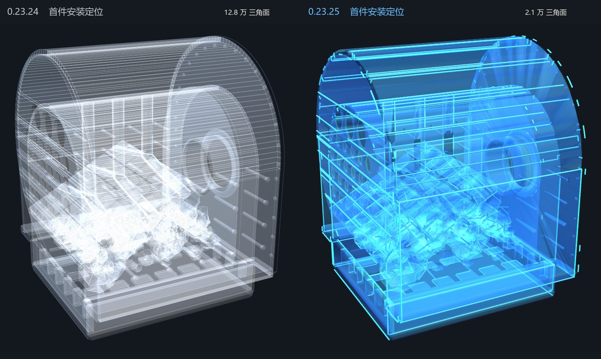
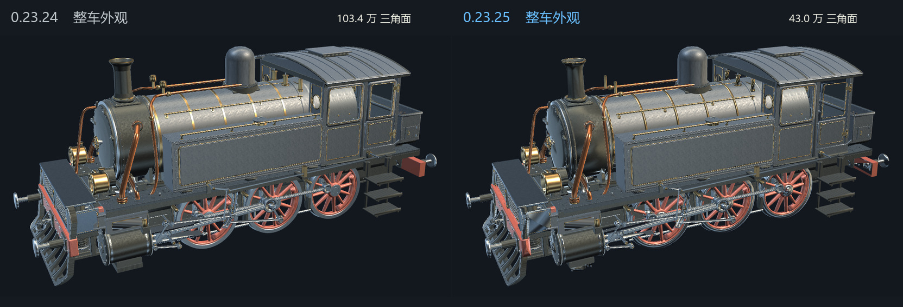

# Steam Atelier · Swan 0.23.25 头显验收

和伙伴已测的 0.23.24 比较，本轮改动集中在装入首件、启动验证、整车展示和山谷行驶。设备端请使用同一台头显、同一刷新率和相同录屏设置。

## 工坊几何预算

| 统计范围 | 0.23.24 三角形 | 0.23.25 三角形 |
| --- | ---: | ---: |
| 工坊场景内全部 2,860 个有网格的 MeshFilter 位置，含未激活对象 | 3,667,292 | 1,113,977 |
| 其中：安装位的结构线 | 657,816 | 24,736 |
| 其中：提示外形及半透明壳 | 915,214 | 165,968 |
| 首件安装位单独显示时的提示模型 | 127,662 | 20,903 |
| 对比图中单独展示的完整实体机车 | 1,034,168 | 430,104 |

总量逐摆放位置计数，同一个网格出现三次计三次。整车零件、未激活的外观、托盘预览、安装位和流体标记池都计入。后三类展示指标有重叠，不应相加。实体、透视、剖面共用一部分几何。延迟加载的山谷、交互碰撞形状、双眼和阴影的额外绘制按其他口径统计。生成器在工坊超过 1,200,000 个三角形时会报错。

减面保留材质槽、原有表面贴图和零件支点，微小紧固件和提示壳优先降密度。已同步装配展示与山谷微缩模型的切换表，防止回工坊后重新引用旧网格。一键组装在 Swan 上复用托盘零件入位，装配过程中原有零件仍参与机械运转。

## 蓝色安装提示和验证

安装位用半透明蓝色面表示可放置体积，用较亮、带实际宽度的蓝色几何线标出结构。原生渲染直接读取普通材质颜色，即使细线在远处变小，面色也能指示位置。进入场景时仍有由下而上的蓝色显现，完成组装沿用金色反馈。

验证模式按可见且已接通的路径采样，每条路径最多四个动态标记，位置更新最高每秒 24 次。关闭或隐藏时停止标记写入。工坊可见性按安装状态变化更新。山谷行驶降低云烟更新频率，减少烟团和重复写入的变换。

## 本机验证

从保存的头显场景读取网格与材质，在 Unity 2022.3.5f1c1 的独立测试工程复核预算并以同机位、同光照截图。另行验证了空路径、125 个活动流场、关闭验证和重置时的标记回收。此次截图和计数来自编辑器。专用 SDK 下双眼画面、真实房间中的可读性和设备帧率由以下一轮验收确认。

## 伙伴一次复测

1. 在已有四个本地 SDK 依赖的打包机更新约定分支并取齐 Git LFS 文件。运行 `Tools/Check-V23Dependencies.ps1`，用工程指定的 Unity 2022.3.62f2c1 运行 `Tools/Build-SwanJourney.ps1`。版本号为 0.23.25，versionCode 为 25。生成报告在 `Builds/SwanJourney/workshop-mesh-budget.json`，APK 在同目录。
2. 记录启动时的装配状态。重置为空台，观察首件安装位，试一下偏亮的真实背景和斜视角。装入“燃烧与进风”后拉近，检查锅炉、铆钉、铜管和下一个蓝色安装位。两种状态各停留约 10 秒并记录 APP FPS。
3. 逐步接通工作链后，验证关闭、开启、再次关闭各保持约 10 秒，记录 APP FPS 并观察工作介质的运动。运行中拆下再装回一个模块，观察中断和恢复。一键装完，切换实体、透视和剖面，观察轮缘、连杆、车顶剪影和原有材质。
4. 进入山谷，停车约 10 秒，再行驶一整圈，经过隧道并制动。记录停车与行驶各自的 APP FPS。返回工坊，再检查实体和剖面。
5. 保留同一轮录屏和设备日志。用 `python Tools/Summarize-JourneyCpuTimings.py device.log --out timing.json` 汇总，可按装配数量、验证开关、观察模式和行车状态分组。以头显报告的 APP FPS 判定流畅度。
